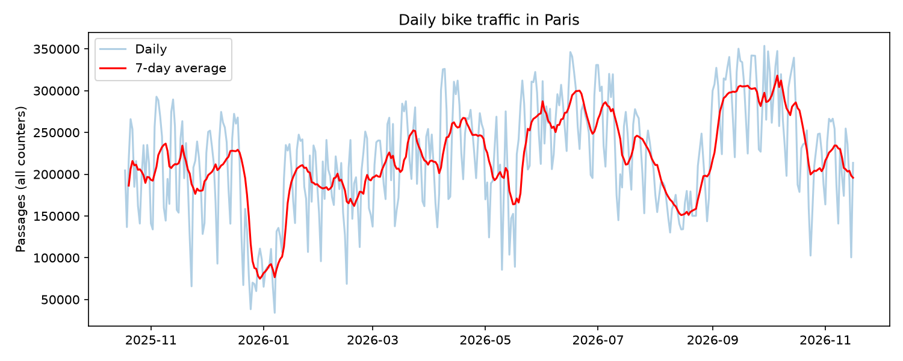
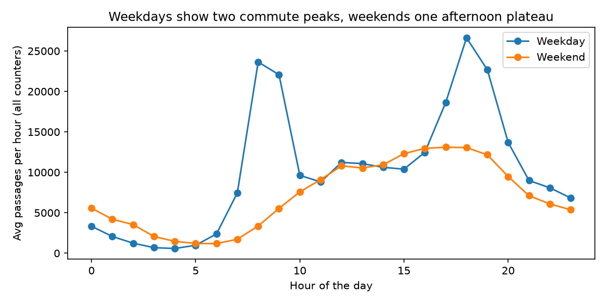
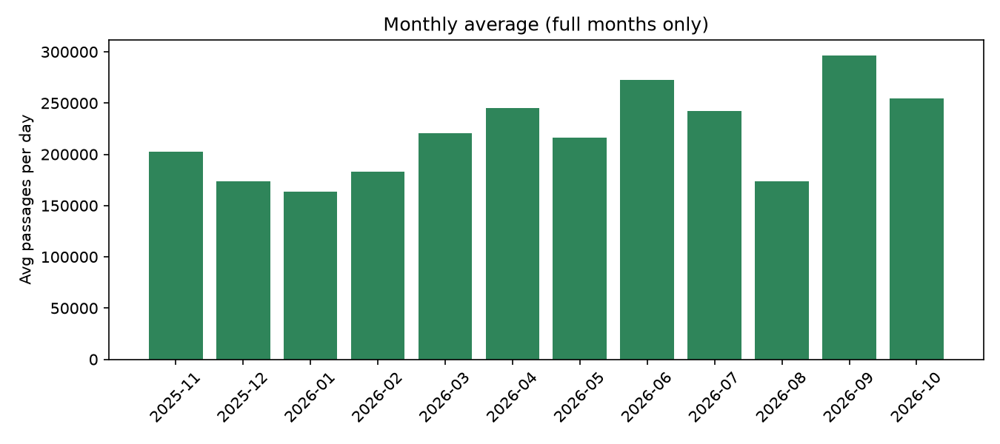

# Paris Cycling Traffic Dashboard

[](https://github.com/BilalBess/paris-cycling-dashboard/actions/workflows/ci.yml)

Interactive dashboard (Streamlit + Plotly) built on **1 million hourly measurements from 113 automatic bike counters in Paris** (open data, Oct 2025 - Nov 2026).
I also wrote a guide to rebuild the same report in **Power BI** (DAX measures included).

## Business questions
- How much does cycling traffic change between weekdays and weekends?
- At what hours is it busy, and does it look like commuting?
- How strong is the seasonality (summer holidays, winter)?
- Which streets have the most traffic?

## Data
- Paris open data, dataset `comptage-velo-donnees-compteurs` (hourly counts per counter and direction).
- The dataset is a rolling window of about 13 months, so if you re-run the download you will get a slightly different period. The processed files I used are in `data/processed/` so the dashboard works directly after cloning.

## Pipeline
1. `src/prepare_data.py`: download the raw file (about 1M rows), then
   - convert timestamps from UTC to Paris time (otherwise the commute peaks are shifted by 1-2 hours),
   - remove duplicates and drop the 1,315 rows with a missing count (a missing value is not a zero),
   - build 3 small tables: `daily_counts`, `counters`, `hourly_profile`,
   - flag a day as `complete_day` only if the counter reported at least 20 hours. Incomplete days would make the average look lower than reality.
2. `app.py`: Streamlit dashboard with filters (period, counters), KPI cards, time series with a 7-day average, weekday and hourly profiles, monthly bars, a map and a top 10.
3. `src/make_figures.py`: static figures for this README.
4. `powerbi/POWER_BI_GUIDE.md`: model, DAX measures and visuals to rebuild it in Power BI.

## Main findings
- **Total: 85.7 million passages** on complete days over the period, about **219,000 per day** on average across the 113 counters.
- **Weekends are 30% quieter** than weekdays. Weekday traffic is mostly commuting.
- **Two commute peaks on weekdays**: 8-9 am and 6-7 pm (the evening peak is the strongest, around 26,600 passages per hour across all counters at 6 pm). At the weekend there is a flat afternoon plateau instead.
- **Seasonality**: the busiest month is September 2026 (about 297,000 passages per day), the quietest full months are January, December and August (all around 163,000-174,000 per day). **August is 36% lower than June**, which fits with the summer holidays (people who commute are away).
- **Busiest counters**: boulevard de Sebastopol (both directions), boulevard de Magenta and rue de Rivoli.





## Limitations
- I only have counters, not the weather. Some of the very low days (for example a very low day in early January 2026) are probably bad weather or strikes, but I did **not** verify the cause. Adding weather data would be the next step.
- Counters measure passages, not unique cyclists. A person who passes two counters is counted twice.
- The most visited streets are the ones equipped with counters, so the map is not a full picture of cycling in Paris.
- Only 13 months, so I cannot compare the same month between two years.

## How to run
```bash
pip install -r requirements.txt
streamlit run app.py          # works directly with the files in data/processed
# optional: refresh the data (downloads about 90 MB)
python src/prepare_data.py
python src/make_figures.py
```

## Tests
```bash
pip install pytest
pytest -q
```
The tests cover the cleaning (duplicates, missing values, UTC to Paris time, complete days) and a smoke test of the Streamlit app. They run on every push with GitHub Actions (`.github/workflows/ci.yml`: lint with ruff, then pytest).

## Docker
```bash
docker build -t paris-cycling-dashboard .
docker run -p 8501:8501 paris-cycling-dashboard
```
Then open http://localhost:8501.

## Skills shown
Data cleaning (time zones, duplicates, missing data), feature engineering, KPI design, Streamlit, Plotly, Power BI / DAX knowledge, communicating insights.
